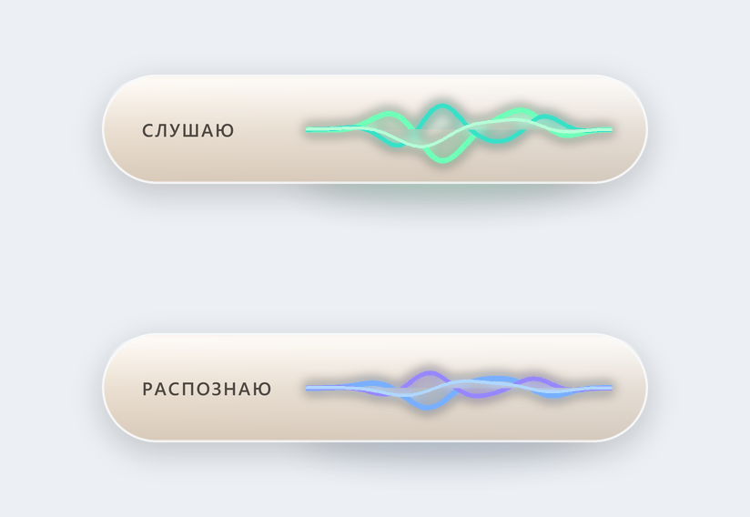

# Голосовой ввод: говорите, а Claude печатает

**Зажали клавиши, сказали, отпустили, и текст встал туда, где мигал курсор. Работает в любом окне, считает на вашем компьютере, звук никуда не уходит.**

Метки: голосовой ввод · Claude Code · GigaAM · Whisper · Windows

---

## Кому это нужно и какая боль

Вы много общаетесь с Claude, и приходится много писать. Своего голосового ввода у Claude Code нет. Можно диктовать встроенной диктовкой Windows, так мы и делали раньше. Но своя программа ошибается заметно реже, и писать ею проще: не поправляешь каждую строку.

## Что нужно

- Компьютер или ноутбук с Windows.
- [Claude Code](https://code.claude.com/docs/en/overview): нужен платный тариф Claude. Установка: откройте PowerShell (в начале строки должно стоять `PS`), выполните `irm https://claude.ai/install.ps1 | iex`, потом откройте новое окно PowerShell и проверьте `claude --version`. При первом запуске он попросит войти в аккаунт.
- Вечер времени. Видеокарта не нужна.

## Два движка: GigaAM и Whisper

«Движок» это программа, которая превращает голос в текст. Их два, оба бесплатные и работают у вас на компьютере:

- **GigaAM** от Сбера, создан для русского языка.
- **Whisper** от OpenAI, универсальный, знает много языков.

Мы начинали с Whisper, потом перешли на GigaAM. На Whisper фраза в 7 секунд обрабатывалась около 10 секунд, на GigaAM около 0,4 секунды. Это на нашем ноутбуке без видеокарты. Но работает и то, и то, у вас может получиться иначе. Можно поставить оба и сравнить на своих фразах.

## Что делать

«Промпт» это письменное задание для Claude. Заведите пустую папку (например `C:\GolosVvod`), в PowerShell перейдите в неё (`cd C:\GolosVvod`), запустите `claude` и напишите ему:

> Прочитай https://raw.githubusercontent.com/msattarovkzn/claude-voice-input/main/prompts/01-sobrat-programmu.md и сделай по этой инструкции. Сначала покажи план и жди моего «да»

Эта инструкция лежит здесь, её можно открыть и прочитать до запуска: [prompts/01-sobrat-programmu.md](prompts/01-sobrat-programmu.md). Дальше Claude идёт по шагам:

1. **Покажет план простыми словами** и ждёт вашего «да».
2. **Проверит, стоит ли Python.** Если нет, скажет, откуда скачать: [python.org/downloads](https://www.python.org/downloads/). При установке отметьте галочку «Add python.exe to PATH». Если Windows открывает вместо Python магазин Microsoft Store, ставьте с python.org.
3. **Скачает движок.** По умолчанию GigaAM: [github.com/salute-developers/GigaAM](https://github.com/salute-developers/GigaAM), запускается через открытый пакет onnx-asr: [github.com/istupakov/onnx-asr](https://github.com/istupakov/onnx-asr). Хотите Whisper, скажите Claude об этом: [github.com/openai/whisper](https://github.com/openai/whisper).
4. **Соберёт программу в своей папке** (все пакеты ставит в отдельную папку `venv`, чтобы не засорять компьютер) **и проверит её тестами.**
5. **Если какой-то сайт попросит зарегистрироваться**, Claude скажет вам, и вы пройдёте регистрацию сами. Паролей и ключей он не просит, и вы ему их не диктуйте.

От вас: нажимать «да» на его вопросы.

## Проверка: работает ли

1. У часов (справа внизу, иногда под стрелкой «скрытые значки») появился значок программы.
2. Поставьте курсор в любое поле, где можно печатать. Зажмите клавиши (по умолчанию **Ctrl+Shift**). Внизу экрана появится полоска «Слушаю».
3. Скажите фразу и отпустите клавиши. Полоска покажет «Распознаю», и через секунду-две текст встанет под курсор.

Если Ctrl+Shift у вас переключает раскладку, попросите Claude подобрать другие клавиши.

*Так выглядит полоска у нас: сверху «Слушаю», снизу «Распознаю».*

## Как программа учится

Раз в несколько дней просите Claude просмотреть журнал диктовок, найти кривые слова и предложить замены. Вы смотрите список и говорите «да» или «нет». Готовое задание: [prompts/02-slovar-zamen.md](prompts/02-slovar-zamen.md).

---

Теги: голосовой ввод · диктовка · GigaAM · Whisper · Claude Code · Windows
